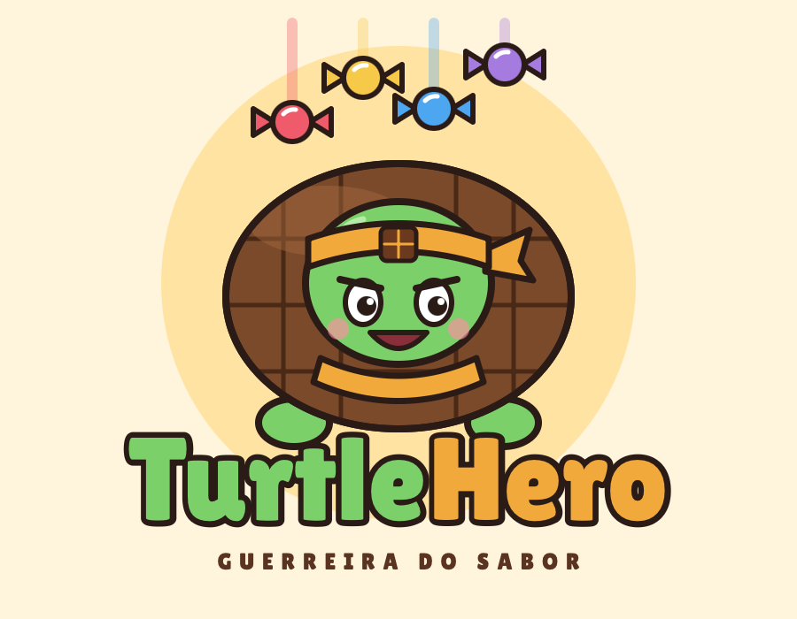

# FECAP - Fundação de Comércio Álvares Penteado

<p align="center">
<a href= "https://www.fecap.br/"></a>
</p>

# TurtleHero

## Nome do Grupo

TurtleHero

## Integrantes: <a href="https://www.linkedin.com/in/murilo-ribeiro-vasconcellos-5bb6493b0/">Murilo Ribeiro Vasconcellos</a>, <a href="[LINK DO LINKEDIN]">Alessandro Galvao Silva</a>, <a href="[LINK DO LINKEDIN]">Valeska Affonso Marques</a>

## Professores Orientadores: <a href="https://www.linkedin.com/in/victorbarq/">Victor Bruno Alexander Rosetti de Quiroz</a>

## Descrição

<p align="center">

</p>

**TurtleHero** é um jogo de ritmo 3D, no estilo *Guitar Hero*, desenvolvido na **Unity** com **C#**. O jogador controla a **TurtleHero** (a Tortuguita transformada em guerreira do sabor) e acompanha notas que descem por 4 pistas, apertando o botão correspondente quando elas chegam à zona de acerto. Cada acerto causa dano ao boss; cada erro custa uma das 3 vidas.

No mundo doce da Arcor, três bosses malignos (**Big Big Bigão**, **7Belos** e **Plutonita**) aprisionaram 12 doces em suas fortalezas, 4 por boss. Para libertá-los, o jogador precisa derrotar os três bosses no ritmo. Cada doce libertado vai para a **caixa de bombom** e desbloqueia uma **curiosidade real** sobre o produto, unindo diversão, recompensa afetiva e conteúdo educativo.

O projeto foi desenvolvido em grupo de 3 integrantes, com apoio de IAs generativas. Todo o planejamento está no **GDD** (versão 1.15), na pasta `documentos`, e o processo de criação com IAs (prompts, erros e correções, comparação entre as IAs e créditos de assets) está na seção 7 dele.

### 🎯 Diferenciais

- Mistura de **ritmo + batalha contra boss + colecionismo**.
- **Recompensa educativa e afetiva**: curiosidades reais sobre doces Arcor.
- **Pontuação e combo** que incentivam a precisão, além de derrotar o boss.
- Regras simples (4 botões e 3 vidas), acessíveis a diferentes idades, com foco no público jovem.
- Identidade visual desenhada à mão, colorida e temática de doces.

### 🎮 Como jogar

- 4 botões fixos na parte inferior da tela; as notas descem até a **zona de acerto**.
- Aperte o botão da pista correspondente quando a nota chegar nele.
- O acerto é avaliado em **Perfeito**, **Bom** ou **Errou**.
- Acertos causam dano ao boss (Perfeito causa mais dano que Bom); **Errou** faz você perder 1 das **3 vidas**.
- Zerar a barra de vida do boss (**HP BOSS**) vence a fase; perder as 3 vidas é derrota.
- Cada boss derrotado liberta 4 doces, que vão para a caixa de bombom. Clique em um doce para ler sua curiosidade.
- O menu inicial tem as opções **Jogar** e **Sair**, e cada fase termina em uma tela de vitória ou de derrota com a pontuação final.

| Resultado | Efeito no boss | Efeito no jogador |
| --- | --- | --- |
| Perfeito | Dano maior | Nenhum |
| Bom | Dano menor | Nenhum |
| Errou | Sem dano | Perde 1 vida |

### ⭐ Pontuação e combo

Os pontos de cada acerto são os pontos base multiplicados pelo multiplicador de combo. Um **Errou** zera o combo. Os valores são propostas iniciais, ajustadas nos testes de usabilidade.

| Resultado | Pontos base | Efeito no combo |
| --- | --- | --- |
| Perfeito | 100 | +1 |
| Bom | 50 | +1 |
| Errou | 0 | volta a 0 |

| Combo atual | Multiplicador | Exemplo (Perfeito) |
| --- | --- | --- |
| 0 a 9 | x1 | 100 pontos |
| 10 a 19 | x2 | 200 pontos |
| 20 a 29 | x3 | 300 pontos |
| 30 ou mais | x4 | 400 pontos |

### 👾 Fases e bosses

A velocidade e a densidade das notas aumentam a cada fase. A Fase 1 serve de aprendizado ("como jogar"). A estimativa, a validar nos testes, é de 2 a 4 minutos por fase, ou 10 a 15 minutos para completar as três.

| Fase | Boss | Tema | Dificuldade | Visual do boss |
| --- | --- | --- | --- | --- |
| 1 | Big Big Bigão | Chiclete | Menor (aprendizado) | Cabeça rosa de chiclete, cabelo de goma e boca enorme |
| 2 | 7Belos | Caramelo | Intermediária (notas mais rápidas e densas) | Rosto de carta de baralho, com naipes nos olhos e cartas de 7 voando |
| 3 | Plutonita | Espacial | Maior (padrão mais exigente) | Planeta roxo com anel, olhos amarelos, dentes pontudos e naves ao redor |

### 🍬 Doces libertados e curiosidades

| Fase | Doce | Curiosidade desbloqueada |
| --- | --- | --- |
| 1 | Big Big | Chiclete de sabor intenso e duradouro, queridinho das crianças. |
| 1 | Poosh | A definir pela equipe. |
| 1 | Rocklets | Confeitos coloridos que também viraram tabletes e ovos de Páscoa. |
| 1 | Block | Conhecido pela espessura e sabor marcante, com amendoins inteiros crocantes. |
| 2 | 7Belo | Caramelo mastigável clássico, um dos mais icônicos da Arcor. |
| 2 | Pirulito 7Belo | A definir pela equipe. |
| 2 | Butter Toffees | Caramelo com textura suave. A Arcor é a maior produtora mundial de caramelos duros. |
| 2 | Torrone | A definir pela equipe. |
| 3 | Plutonita | Chiclete saborizado com identidade espacial, famoso nos anos 90/2000. |
| 3 | Bon o Bon | Criado em 1984 na Argentina, inspirado no brasileiro Serenata de Amor. Vendido em mais de 80 países. |
| 3 | Tortuguita | Lançada no Brasil em 1995. Seu chocolate é enriquecido com cálcio, vitaminas e ferro. (O doce que inspirou o herói!) |
| 3 | Chocolate ao Leite | A definir pela equipe. |

> Poosh, Pirulito 7Belo, Torrone e Chocolate ao Leite são sugestões a confirmar, conforme o GDD.

### 🖼 Estilo visual e telas

O visual segue o esboço da equipe: desenho à mão, com contorno escuro, textura de lápis e cores suaves, em telas verticais. Na tela de batalha, o boss fica no topo, a barra **HP BOSS** logo abaixo, a pista de 4 colunas no meio, os 4 botões quadrados na base da pista e, na faixa inferior, a TurtleHero no canto esquerdo e as 3 vidas (cascos) ao centro. As artes, os fluxogramas e as telas (menu, vitória, derrota, caixa de bombom e curiosidade) estão no GDD.

### 🧮 Como funciona por dentro

Os conceitos de Física e Matemática aplicados em C# (seção 6 do GDD):

- **Queda das notas:** movimento retilíneo uniforme, `transform.position += Vector3.down * speed * Time.deltaTime`.
- **Vetores:** cada nota tem posição `(x da pista, y)` e velocidade `(0, -v)`.
- **Julgamento do acerto:** função definida por partes, comparando a distância `d` entre a nota e a zona de acerto com as janelas de Perfeito e de Bom.
- **Barra de vida do boss:** proporção `vida atual ÷ vida máxima`.

Os valores de balanceamento (dano por acerto, vida do boss, velocidade das notas e janela de acerto) ficam em variáveis ajustáveis no Inspector da Unity.

## 🛠 Estrutura de pastas

```
Raiz
├── documentos
│   └── GDD_TurtleHero_v1_15.docx
├── executáveis
│   └── windows
├── imagens
├── src
│   ├── Assets
│   ├── Packages
│   └── ProjectSettings
└── README.md
```

- **documentos**: toda a documentação do projeto, incluindo o GDD (Documento para Design de Games) do TurtleHero.
- **executáveis**: binários e executáveis do projeto.
- **imagens**: imagens do sistema (arte do herói, bosses, doces e telas).
- **src**: projeto Unity (código-fonte em C#, cenas e assets).
- **README.md**: guia e explicação geral do projeto, o arquivo que você está lendo agora.

## 🛠 Instalação

**Windows:**

Não há instalação! Apenas executável.
Encontre o `TurtleHero.exe` na pasta `executáveis/windows` e execute-o como qualquer outro programa.

## 💻 Configuração para Desenvolvimento

Para abrir este projeto você precisa das seguintes ferramentas:

- <a href="https://unity.com/download">Unity Hub e Unity Editor</a> (versão: 6000.3.6f)
- Uma IDE com suporte a C# (Visual Studio ou VS Code)
- <a href="https://git-scm.com/">Git</a>

Passo a passo:

```sh
git clone https://github.com/2026-2-MCC1/Projeto3.git
```

1. Abra o Unity Hub e clique em **Add > Add project from disk**.
2. Selecione a pasta `src` do repositório.
3. Abra o projeto com a versão do Unity indicada acima (o Hub oferece a instalação, se necessário).
4. Abra a cena do menu inicial e clique em **Play**.

## 📚 Documentação

O GDD (`documentos/GDD_TurtleHero_v1_15.docx`) reúne:

1. Visão geral: objetivos, público-alvo, diferenciais, matriz SWOT, Value Proposition Canvas, requisitos, persona e histórias de usuário.
2. Game Design: história, fluxo do jogo, mundo, telas, doces, pontuação e balanceamento.
3. Level Design: as três fases e seus bosses.
4. Personagens: TurtleHero, bosses e doces aprisionados.
5. Teste de usabilidade.
6. Relatório de Física e Matemática.
7. Documentação do processo de desenvolvimento com IAs (IAs utilizadas, prompts, problemas e correções, comparação e créditos).
8. Bibliografia.

## 🤖 IAs e assets utilizados

O detalhamento completo (prompts, respostas, erros e correções) está na seção 7 do GDD. Resumo dos assets e créditos:

| Asset | Tipo | Fonte e autor | Licença / termos |
| --- | --- | --- | --- |
| Unity Editor | Engine | Unity Technologies, <https://unity.com> | [confirmar: Unity Personal / Education] |
| Arte do jogo (herói, bosses, doces, telas e interface) | Imagens | [informar se foi criada pela equipe ou gerada com IA e qual ferramenta] | [licença ou termos de uso da ferramenta] |
| Músicas e efeitos sonoros | Áudio | [link e autor] | [licença, ex.: CC0 / CC BY] |
| Fontes tipográficas | Fonte | [link e autor] | [licença] |
| Marcas e produtos Arcor (nomes, doces e curiosidades) | Marca / referência | Arcor (marcas de terceiros) | Sem licença de uso comercial; uso apenas acadêmico |

## 📋 Licença/License

O jogo usa nomes, doces e curiosidades de marcas da **Arcor** (marcas de terceiros), sem licença de uso comercial: o projeto é de uso **apenas acadêmico e sem fins comerciais**, e o jogo não deve ser distribuído comercialmente.

Código e materiais autorais do grupo: utilize o link <https://chooser-beta.creativecommons.org/> para gerar uma licença CC BY 4.0 e adicione-a aqui.

## 🎓 Referências

Aqui estão as referências usadas no projeto.

1. <https://github.com/iuricode/readme-template>
2. <https://github.com/gabrieldejesus/readme-model>
3. <https://chooser-beta.creativecommons.org/>
4. <https://www.toptal.com/developers/gitignore>
5. UNITY TECHNOLOGIES. **Unity Manual** e **Scripting API**. Disponível em: <https://docs.unity3d.com>. Acesso em: [data].
6. UNITY TECHNOLOGIES. **Unity Download**. Disponível em: <https://unity.com/download>. Acesso em: [data].
7. CSIKSZENTMIHALYI, Mihaly. **Flow**: the psychology of optimal experience. New York: Harper & Row, 1990.
8. TURTLEHERO. **Documentação Oficial do Projeto**: versão 1.0, conceito inicial. Documento interno da equipe, 2026.
9. Músicas, efeitos sonoros, fontes e demais assets externos: [informar autor, link, licença e data de acesso, conforme a seção 7.7 do GDD].
